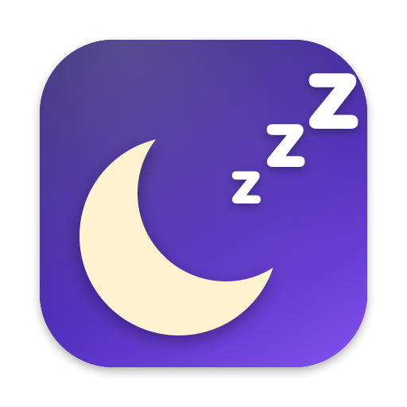
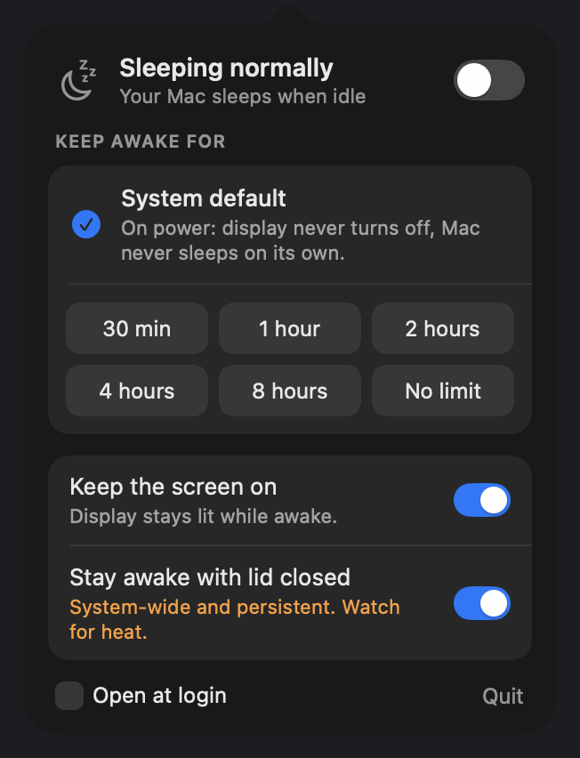
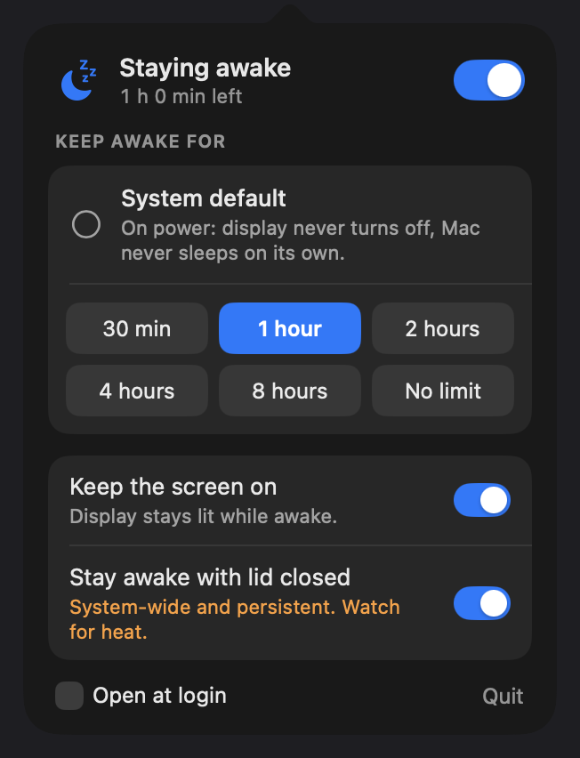

<p align="center">
  
</p>

<h1 align="center">Stay Awake</h1>

<p align="center">A tiny macOS menu bar app that keeps your Mac awake for as long as you choose.<br>
No Dock icon, no window, no background service. Liquid Glass on macOS 26.</p>

<p align="center">
  
</p>

## What it does

- Lives in the menu bar as an outlined moon (off) or a filled moon with a countdown next to it (on).
- **System default** is always the first option. It shows what your Mac would do on its own, read live from your power settings, and picking it turns the app off.
- Keep awake for **30 min, 1, 2, 4, 8 hours, or with no limit**. A notification tells you when the timer ends.
- **Keep the screen on**, or let the display turn off while the Mac stays awake (downloads, builds, servers).
- Optional **stay awake with the lid closed**. This one is a system-wide setting and asks for your password. Read the warning below before using it.
- Open at login. Quit. That is the whole feature list.

Nothing persists after you quit. If the app crashes or you force-quit it, macOS goes straight back to normal sleep. No `caffeinate` processes, no launch agents, no password (except the lid option).

## Install

Needs macOS 14 or later. Liquid Glass appears on macOS 26; older versions get a standard translucent panel.

### Option A: build it yourself (recommended, about 20 seconds)

The only requirement is Apple's Command Line Tools, which give you the Swift compiler. No Xcode needed.

```bash
xcode-select --install      # skip if you already have it
git clone https://github.com/anupam0309/StayAwake.git
cd StayAwake
./build.sh --install
```

That compiles the app, copies it to `/Applications`, and opens it. Look for the moon icon in the menu bar. Because you built it on your own machine there is no Gatekeeper warning.

### Option B: download the app

Grab `StayAwake-x.y.zip` from the [Releases](https://github.com/anupam0309/StayAwake/releases) page, unzip it, and move `StayAwake.app` to `/Applications`.

The app is not notarized (that needs a paid Apple developer account), so macOS will refuse to open a downloaded copy. Clear the quarantine flag once and it opens normally:

```bash
xattr -dr com.apple.quarantine /Applications/StayAwake.app
open /Applications/StayAwake.app
```

Or: try to open it, then go to System Settings › Privacy & Security and click **Open Anyway**.

## Using it

<p align="center">
  
</p>

Click the menu bar icon. The panel drops down right under it as a translucent glass popover (the screenshots here were captured from the window alone, so the background looks solid). It closes when you click anywhere else, and it never takes keyboard focus away from the app you were using. Right-click the icon for a quick Quit.

| Row | What it does |
|---|---|
| **Switch** at the top | On / off. Off is the same as picking System default. |
| **System default** | Your Mac's own behaviour, for example "On power: display off after 10 min, Mac sleeps right after". Selected whenever the app is off. |
| **30 min … No limit** | Start keeping the Mac awake for that long. Picking a new length restarts the clock. |
| **Keep the screen on** | On: the display stays lit. Off: the display sleeps on its normal schedule while the Mac keeps running. |
| **Stay awake with lid closed** | Sets macOS to keep running with the lid shut. System-wide, persistent. See below. |
| **Open at login** | Starts the app with your Mac, always in the off state. |

The menu bar shows the remaining time while a timer runs:

<p align="center">
  
</p>

## The lid option, read before using

Everything else in this app is temporary and dies with the process. The lid option is different: it runs `pmset -a disablesleep 1`, which is a system-wide setting that

- **survives quitting the app and rebooting**, until you turn it off again, and
- keeps a closed MacBook fully running, so **watch the heat**. Use it with an external display or on a hard surface with airflow, never in a bag.

Turn it off from the same switch, or from a terminal:

```bash
sudo pmset -a disablesleep 0
```

The app reads the real value from the system every time the panel opens, so the switch always reflects what macOS is actually doing.

## How it works

Two IOKit power assertions, held in-process:

| Assertion | Held when |
|---|---|
| `PreventUserIdleSystemSleep` | The app is on |
| `PreventUserIdleDisplaySleep` | The app is on and "Keep the screen on" is ticked |

That is the same mechanism video players and `caffeinate` use. It needs no privileges and it cannot outlive the process. See exactly what is holding your Mac awake, this app included:

```bash
pmset -g assertions
```

The "System default" text comes from `pmset -g`, read fresh whenever the panel opens. The app never changes those values.

The app installs no keyboard shortcuts, event taps or accessibility hooks, and it never activates itself, so your keyboard focus stays where it was.

## Uninstall

1. Quit the app from the panel or by right-clicking the icon.
2. If you ever turned on the lid option, run `sudo pmset -a disablesleep 0`.
3. Delete `/Applications/StayAwake.app`. If "Open at login" was on, remove the entry in System Settings › General › Login Items & Extensions.

## Development

```
Sources/StayAwake.swift   the whole app, one file
Tools/make-icon.swift     draws the icon and writes Resources/AppIcon.icns
build.sh                  compiles with swiftc and ad-hoc signs the bundle
```

```bash
./build.sh            # build into ./StayAwake.app
./build.sh --icon     # re-render the icon first
./build.sh --install  # build, copy to /Applications, open
```

Two environment variables help when testing, both ignored unless set:

- `STAYAWAKE_TEST_SECONDS=5` shortens every timed option to 5 seconds so you can watch a timer expire.
- `STAYAWAKE_DEBUG=1` makes the app listen for distributed notifications named `com.anupam0309.stayawake.debug` with a command string as the object (`open`, `close`, `on:3600`, `off`, `screen:0`, `login:1`, `snap:/path.png`). Used to drive the UI and capture the images in this README.

## FAQ

**The icon is not there.** On a MacBook with a notch the menu bar can run out of room and macOS hides the icons that do not fit. Quit something else in the menu bar, or hold ⌘ and drag icons to reorder them.

**System default says "display never turns off".** That is what your power settings currently say. Check with `pmset -g custom` and change it in System Settings › Lock Screen (display) and › Battery (sleep). `sudo pmset restoredefaults` restores Apple's defaults.

**Does it stop sleep when I choose Apple menu › Sleep or the battery runs out?** No. It only prevents *idle* sleep. Explicit sleep, low battery and the lid (unless you use the lid option) behave as usual.

**Why not just `caffeinate`?** You can. `caffeinate -di -t 3600` does most of this. This app is for seeing the state at a glance and changing it in two clicks.

## License

MIT. See [LICENSE](LICENSE).
